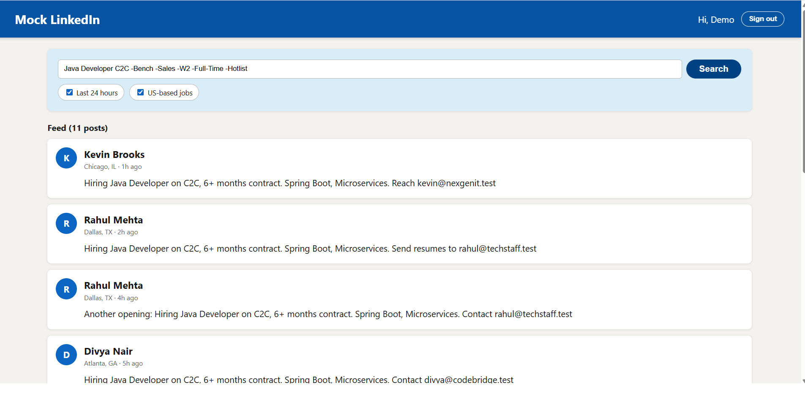
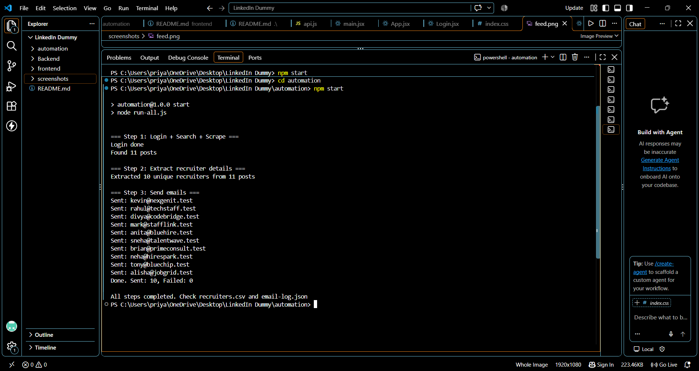
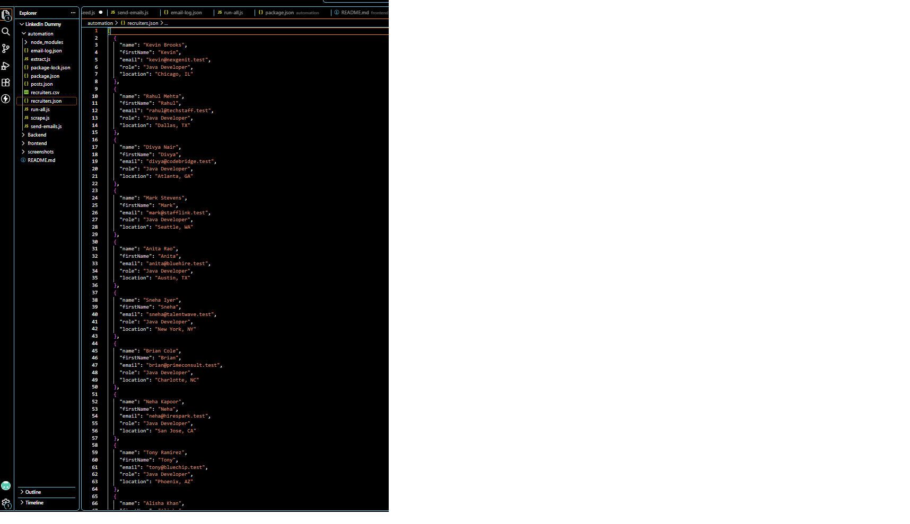
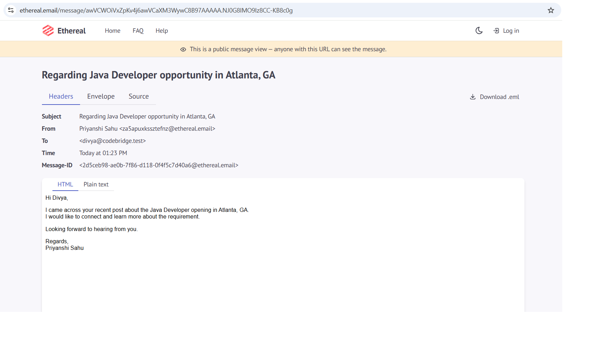

# LinkedIn Recruiter Outreach Automation (Mock Platform Demo)

This project demonstrates the API C2C task flow on a **mock LinkedIn-like platform**.
Real LinkedIn's Terms of Service do not allow automated login and scraping, so the same flow is built and tested on a demo platform with dummy data.

## Tech Stack
- Frontend: React (Vite), Axios, React Router
- Backend: Node.js, Express, MongoDB (Mongoose), JWT
- Automation: Playwright
- Email: Nodemailer with Ethereal (test inbox, no real emails are sent)

## Flow
1. Auto login on the mock platform
2. Search posts with keywords: `Java Developer C2C Bench Sales W2 Full-Time Hotlist`
3. Apply filters: last 24 hours and US-based jobs
4. Extract recruiter details (name, email, role, location) and remove duplicates
5. Send emails using a template with placeholders (`{{firstName}}`, `{{role}}`, `{{location}}`)

Note: the demo data has 11 matching posts. One recruiter posted twice, so duplicates are removed and 10 unique recruiters receive emails.

## Project Structure
```
Backend/      Express API, models, seed script
frontend/     Mock LinkedIn UI (login, feed, filters)
automation/   scrape.js, extract.js, send-emails.js, run-all.js
screenshots/  Images used in this README
```

## Setup
1. Start MongoDB locally.
2. Backend: create a `.env` file inside `Backend/`
   ```
   MONGO_URI=mongodb://127.0.0.1:27017/mock-linkedin
   JWT_SECRET=anything123
   PORT=5000
   ```
   Then run:
   ```
   cd Backend
   npm i
   npm run seed
   npm run dev
   ```
3. Frontend (new terminal):
   ```
   cd frontend
   npm i
   npm run dev
   ```
4. Automation (new terminal):
   ```
   cd automation
   npm i
   npx playwright install chromium
   npm start
   ```

Demo login: `demo@test.com` / `demo123`

Note: This demo uses a single pre-seeded user (created by `npm run seed`). User registration is not part of the task scope, since the automation logs in with this account. A signup flow can be added as a future improvement.

`npm start` runs the complete flow in one command: login, search, extract, and send emails.

## Output Files
- `posts.json`: scraped posts
- `recruiters.json` and `recruiters.csv`: extracted recruiter details
- `email-log.json`: sent/failed status with preview links

## Screenshots

### Mock platform with filters applied


### Automation run


### Extracted recruiters


### Email preview (Ethereal test inbox)


## Adapting to Real LinkedIn
- Use official LinkedIn APIs or partner access instead of scraping
- Send emails only to recipients who have given consent
- Replace the template in `automation/send-emails.js` (`SUBJECT` and `BODY`) with the team's email format